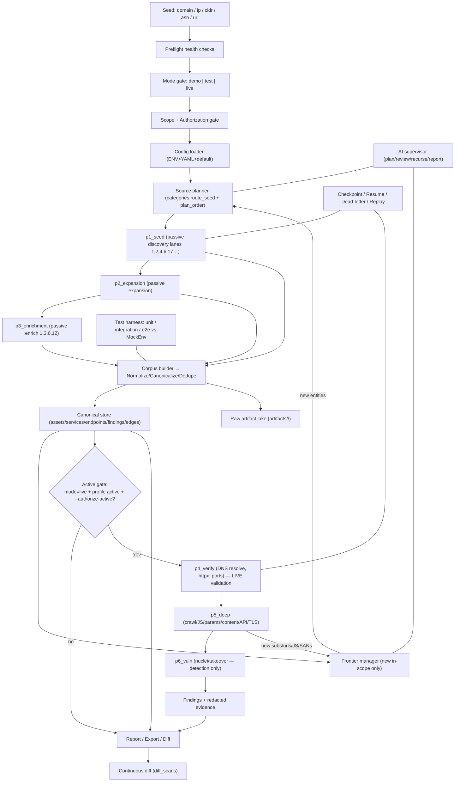

# D14 — Architecture Review, Flow Diagram & Gap List

> Consolidated review of the implemented system against the full design spec,
> including the end-to-end flow diagram and an honest, current gap list.

## 1. Architecture summary

Recontool is a **config-driven, frontier-driven, fully testable** authorized-recon
pipeline. Its design holds up well:

**Strengths**
- **Single source of record + single writer.** Adapters are pure (emit `Event`s);
  the `Normalizer` is the only DB writer (idempotent upserts, deterministic dedupe
  keys, noisy-OR confidence). This makes the whole system deterministic and testable.
- **Two integration tiers.** Hand-written adapters for high-value sources + a
  declarative generic engine (`tools_generic.yaml`) so the long tail of tools is
  config, not code.
- **28-category registry as a contract.** `categories.yaml` declares I/O types,
  dedupe keys, chain_to, retry/quota profiles, recursion triggers, and storage per
  lane; validated at preflight and in unit tests.
- **Layered safety.** Run-mode (demo/test/live) > scope gate (deny>allow) >
  active-authorization gate. Single HTTP egress chokepoint enforces all three plus
  rate limiting, circuit breaking, and budget.
- **Provenance + redaction.** Every asset tracks its sources; secrets are stored as
  hash+mask+location only.
- **Frontier-driven recursion.** Recurse only on *new in-scope* entities.

**Trade-offs / watch-items**
- Canonical graph is **relational** (SQL `Edge` table), not a native graph DB. Fine
  at current scale; a Neo4j mirror is a scale-up option (roadmap).
- `proxy_pool.py` is retained but **deprecated** under the no-evasion policy.
- Adapter breadth: ~17 of 28 categories have executable adapters today; the rest are
  fully specified (registry + generic-spec ready) but not wired.

## 2. End-to-end flow (as implemented)

## 3. Spec outputs → where they live

| # | Required output | Location |
|---|-----------------|----------|
| 1 | Architecture summary | `docs/00-architecture-overview.md`, §1 here |
| 2 | Flow diagram | §2 here, `docs/flow/00-MASTER-FLOW.md` |
| 3 | Source family / lane matrix | `docs/D1-tool-matrix.md`, `docs/pipeline/04-tool-catalog.md` |
| 4 | Category implementation checklist | `docs/categories/BUILD-CHECKLIST.md` |
| 5 | Storage schema | `docs/D3-data-schema.md` |
| 6 | Scheduler design | `docs/blueprint/04-scheduler-recursion-loops.md`, §4 here |
| 7 | Testing strategy | `docs/D11-testing-strategy.md` |
| 8 | Config schema | `config/recontool.example.yaml` |
| 9 | Implementation roadmap | `docs/D7-roadmap.md`, §6 here |
| 10 | Gap list & fixes | §5 here |
| 11 | Demo-mode E2E plan | `docs/D12-demo-e2e-plan.md` |
| 12 | Operator runbook | `docs/D13-operator-runbook.md` |

## 4. Scheduler / recursion (implemented)

- **Phases**: `p1_seed → p2_expansion → p3_enrichment → [gate] → p4_verify → p5_deep → p6_vuln`.
- **Within a phase**: adapters run in parallel (bounded by `global_concurrency`).
- **Between phases**: discovered assets are read back as next-phase inputs (chaining).
- **Recursion**: `FrontierManager.has_new()` gates another pass; recurse only on new
  in-scope entities (bounded by `max_recursion`; AI may veto for cost).
- **Reliability**: per-provider `CircuitRegistry` + `BudgetLedger` at the HTTP
  chokepoint; failures park in the `dead_letter` table.
- **Resume**: per-phase `Checkpoint` rows; `--resume` skips completed phases.

## 5. Gap list — status after this iteration

| # | Gap (original) | Status | Evidence |
|---|----------------|:------:|----------|
| 1 | Mode demo/test/live + egress enforcement | ✅ done | `core/mode.py`, `net/http_client.py`, tests |
| 2 | Mock/demo environment | ✅ done | `testing/mock_env.py`, `tests/e2e/` |
| 3 | Preflight health checks | ✅ done | `preflight.py`, CLI `preflight` |
| 4 | Checkpoint/resume/dead-letter/replay | ✅ done | `models.Checkpoint/DeadLetter`, pipeline, CLI `replay` |
| 5 | Entity-level frontier manager | ✅ done | `orchestrator/frontier.py`, tests |
| 6 | Circuit breaker + budget wired into egress | ✅ done | `net/http_client.py`, `test_mode_and_egress.py` |
| 7 | Integration + E2E + fixture tests | ✅ done | `tests/integration/`, `tests/e2e/` (85 tests total) |
| 8 | Continuous diff/monitoring | 🟡 partial | `diff.py` + CLI `diff` (engine done; no built-in scheduler/cron) |
| 9 | Missing docs (testing/demo/runbook) | ✅ done | `D11`, `D12`, `D13`, `D14` |
| 10 | Most category adapters empty | 🟡 partial | ~17/28 categories have executable adapters; rest specced |

### Remaining (deliberately deferred)
- **Native graph DB (Neo4j) mirror** — relational edges suffice at current scale.
- **Adapter breadth for cats 7,8,11,15,16,26** — registry + generic-spec ready; wire
  per-need (mechanical via `tools_generic.yaml`, no core changes).
- **Built-in scheduler/cron for continuous monitoring** — diff engine exists; drive
  it from external cron/CI for now.

## 6. Roadmap to full breadth

1. **G1** Remove/!reframe `proxy_pool` to a single declared egress (policy cleanup).
2. **G2** Wire generic specs for cats 7/8/11/15/16/26 (declarative, add to `tools_generic.yaml`).
3. **G3** Learned wordlist/regex packs (cat 28) feeding cats 20/23/25.
4. **G4** Optional Neo4j mirror of the `Edge` table for graph queries/visualisation.
5. **G5** Built-in scheduler for continuous diff + alert sink (notify/interactsh).
