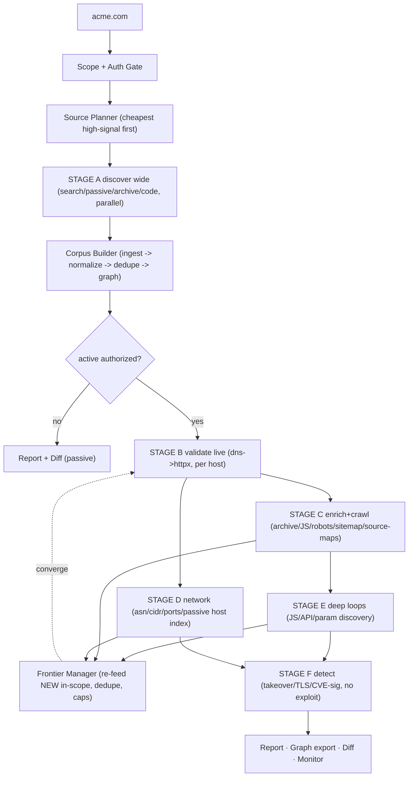

# 01 — Architecture Summary, Flow Diagram & Stage Pipeline

## 1. Architecture summary

OBSERVATORY is a **frontier-driven, corpus-merging recon engine**. One idea organizes
everything: a **canonical graph is the chaining bus**. No tool pipes to another tool;
every adapter writes typed entities + provenance into the graph, and the next stage reads
the graph. This makes the system idempotent, resumable, and source-agnostic.

Seven planes:

```
            ┌──────────────────────────────────────────────────────────────┐
  CLIENTS   │  CLI · API · Web UI (live progress stream)                     │
            └───────────────┬──────────────────────────────────────────────┘
                            ▼
  CONTROL   │ Scope+Auth gate · Source Planner · Scheduler (quota/budget/    │
            │ circuit-breaker) · Frontier Manager · AI Supervisor            │
                            ▼
  ADAPTERS  │ source families behind ONE contract (search · passive indexes ·│
            │ archives · code search · live crawl/render)                    │
                            ▼
  CORPUS    │ Corpus Builder: ingest → raw artifact store (content-addressed)│
            │ → Normalizer → Dedupe → Canonical Graph (single writer)        │
                            ▼
  STATE     │ Graph DB (entities+edges) · Artifact store (sha256) ·          │
            │ Search index · Time-series (asset_state) · Checkpoints         │
                            ▼
  INTEL     │ Live validation · Recursion loops · Diff/monitor · Reports     │
                            ▼
  OBSERVE   │ Telemetry · logs · provenance · replay                         │
```

**Core invariants**
- *Single-writer graph*: only the Normalizer writes canonical entities (dedupe is then tractable).
- *Raw ≠ normalized*: raw bytes live in a content-addressed artifact store; entities link to them by `sha256` + provenance.
- *Frontier convergence*: re-feed only **new in-scope** entities; dedupe makes the entity set monotonic ⇒ guaranteed termination.
- *Discover wide, then per-host*: apex discovery first; every later stage fans out **per discovered host**, not per apex.
- *Validate-live before spend*: resolve + probe before expensive enrichment/crawl.
- *Cheapest high-signal first*: planner orders sources by yield/cost/freshness/redundancy/confidence; archive/search/code pivots run only when they add **unique** coverage.

---

## 2. Complete flow diagram

```
ROOT: acme.com   ──▶ [Scope + Auth Gate] ──▶ scan_id, scope policy, budget ledger
                                   │
                                   ▼
   ┌──────────────────────── SOURCE PLANNER ───────────────────────────┐
   │ for each frontier type, choose cheapest high-signal source family   │
   │ (yield × freshness × confidence ÷ cost, skip redundant)             │
   └───────────────────────────────┬───────────────────────────────────┘
                                    ▼
   ╔══════════════ STAGE A · DISCOVER WIDE (apex, parallel) ════════════╗
   ║ SEARCH:    Brave · Mojeek · Mojeek-Org · SearXNG · (Google PSE/Bing plugin)
   ║ PASSIVE:   Censys · Shodan · SecurityTrails · Chaos · urlscan · CertSpotter
   ║ ARCHIVES:  Wayback CDX · Common Crawl index
   ║ CODE:      GitHub code search · Sourcegraph
   ║            (GreyNoise = context/noise tag, NOT discovery)
   ╚════════════════════════════════╤═══════════════════════════════════╝
                                    ▼  raw artifacts → store (sha256)
   ┌──────────────── CORPUS BUILDER (single merge stage) ───────────────┐
   │ ingest every family → normalize → dedupe → CANONICAL GRAPH          │
   └───────────────────────────────┬───────────────────────────────────┘
                                    ▼
                       ◆ AUTH GATE (active requires authorization)
                                    ▼
   ╔════════════ STAGE B · VALIDATE LIVE (per host, parallel) ══════════╗
   ║ DNS resolve (+wildcard filter) → httpx probe → live_host           ║
   ║ favicon hash · CDN/WAF tag (tuning, NOT bypass) · service/tech      ║
   ╚═════════════╤══════════════════════════════════╤═══════════════════╝
        web track │ (per live_host)        ip/net track │ (per ip)
                  ▼                                     ▼
   ╔═ STAGE C · ENRICH + CRAWL ═╗          ╔═ STAGE D · NETWORK ═══════╗
   ║ archive URLs (CDX/CC) ·     ║          ║ asn/cidr · ports · service║
   ║ live crawl + JS render ·    ║          ║ passive host index pivots ║
   ║ robots/sitemap/manifest ·   ║          ╚════════════╤══════════════╝
   ║ source-maps · favicon pivot ║                       │
   ╚═════════════╤══════════════╝                        │
                 ▼                                        │
   ╔═ STAGE E · DEEP LOOPS ═════════════════════════════╗ │
   ║ JS→endpoints/secrets/frames/websockets/source_maps  ║ │
   ║ OpenAPI/Swagger/GraphQL discovery · param discovery ║ │
   ║ smart wordlist (tech + harvested paths)             ║ │
   ╚═════════════╤══════════════════════════════════════╝ │
                 │  NEW entities (subdomains, SANs, urls, js, endpoints, params)
                 └──────────────────► FRONTIER MANAGER ◄──┘
                         re-feed only NEW in-scope; dedupe; depth/budget caps
                         convergence ⇒ when frontier empty OR budget exhausted
                                    │
                                    ▼
   ╔═ STAGE F · DETECT (no exploitation) ═╗
   ║ takeover · TLS issues · known-CVE signatures · exposure findings    ║
   ╚═════════════╤═══════════════════════╝
                 ▼
   REPORT · GRAPH EXPORT · DIFF (new/changed/gone) · CONTINUOUS MONITOR
```

### Mermaid



---

## 3. Stage-by-stage pipeline

| Stage | Purpose | Input frontier | Key sources / actions | Output entities | Gate |
|-------|---------|----------------|------------------------|-----------------|------|
| **Gate** | scope + budget | seed `domain` | classify, build scope, budget ledger | — | scope |
| **Plan** | choose sources | each frontier type | rank by yield/cost/freshness/redundancy/confidence | plan | — |
| **A. Discover wide** | broad apex discovery | `domain` | search engines, passive indexes, archives, code search (parallel) | `subdomain` `url` `ip` `cert` `repo` `artifact` | passive |
| **Corpus build** | merge all families | raw artifacts | ingest → normalize → dedupe → graph | canonical entities + edges | passive |
| **Gate 2** | authorize active | — | require `active_authorized` | — | **auth** |
| **B. Validate live** | confirm reachable | `subdomain` `ip` | DNS resolve (+wildcard), httpx probe, favicon hash, CDN/WAF tag, tech | `live_host` `service` `tech` `favicon` `tag` | active |
| **C. Enrich + crawl** | per-host coverage | `live_host` | archive URLs, live crawl + JS render, robots/sitemap/manifest, source-maps | `url` `js_file` `frame` `websocket` `source_map` | active |
| **D. Network** | infra mapping | `ip` `asn` | ASN→CIDR, ports→service, passive host index | `cidr` `asn` `service` | active |
| **E. Deep loops** | endpoints/params/APIs | `js_file` `url` | JS mining, OpenAPI/Swagger/GraphQL, param discovery, smart wordlists | `endpoint` `param` | active |
| **Frontier** | recurse | all NEW entities | re-feed new in-scope, dedupe, caps | (loops to B) | — |
| **F. Detect** | findings (no exploit) | `live_host` `url` `service` `cert` | takeover, TLS, CVE signatures, exposure | `finding` | active |
| **Out** | report/diff/monitor | graph | export, diff vs prior, alert, schedule | reports, alerts | — |

**Cheapest-high-signal ordering inside Stage A** (planner default): CT logs (CertSpotter,
Censys certs) + Chaos + free archive (Wayback CDX) + free search (Brave/Mojeek) **first**
(high yield, low/no cost); paid passive indexes (Shodan/SecurityTrails/Censys hosts) and
code search **next** (unique coverage, metered); Common Crawl / heavy crawl **last** (high
cost, run only when they add unique coverage per the redundancy score).

The implemented mapping of these stages to phases (`p1_seed…p6_vuln`) and adapters lives in
`docs/pipeline/03-category-pipelines.md` and `docs/flow/01-PARALLEL-RECURSIVE-ARCHITECTURE.md`.
