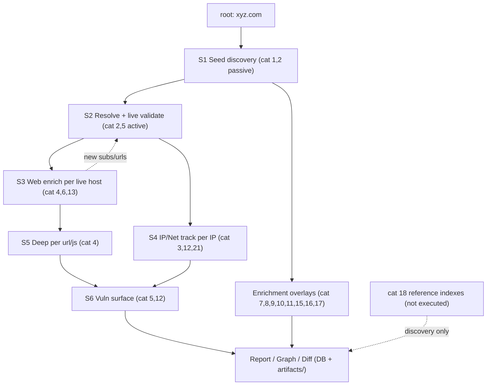

# Master Execution Flow - root domain `xyz.com`

How the full inventory executes end-to-end from a single root domain. Each spreadsheet category maps to a pipeline stage; every tool's invocation, output, chaining, and storage is in the per-category files ([`by-category/`](by-category/)) and in [`../../data/flow_plan.json`](../../data/flow_plan.json).

- **Tools planned:** 532
- **Authoritative invocations (config/tools.yaml):** 55
- **Templated invocations (to be wired):** 477

## Stage pipeline (data handoffs)

```
root: xyz.com
   |
   v  S1  SEED DISCOVERY            cat 1,2 (passive)   -> subdomains, ips, certs, urls
   |     subfinder crtsh shodan censys netlas urlscan uncover hackertarget otx ...
   v  S2  RESOLVE + LIVE VALIDATE   cat 2,5 (active)    -> ip, LIVE hosts
   |     dnsx puredns massdns -> httpx (sets is_live)  [filters 250 -> ~120 live]
   +---------------+-----------------------------------------------+
   v S3 WEB ENRICH | (per LIVE host)        v S4 IP/NET (per IP)     | overlays
   |  cat 4,6: gau waybackurls katana       cat 3: asnmap bgpview    | run on
   |  -> urls,js_file  cat 13: gowitness    cat 12: internetdb       | org/emails
   v S5 DEEP (per url/js)                    cat 21: naabu->nmap      | cat 7,8,9,
   |  cat 4: linkfinder secretfinder arjun   -> services,cves         | 10,11,15,16
   v S6 VULN (per live host)                                          |
   |  cat 5,12: nuclei subjack sslyze -> findings  <----CVE corr------+
   v
  REPORT / EXPORT / GRAPH / DIFF   (DB + artifacts/<scan_id>/)
```

## Mermaid graph



## Categories -> stage map

| Cat | Stage | Tools | Per-category execution detail |
|-----|-------|-------|-------------------------------|
| 1 | S1 Seed discovery | 52 | [by-category/01.md](by-category/01.md) |
| 2 | S1->S2 Subdomain discovery + resolution | 75 | [by-category/02.md](by-category/02.md) |
| 3 | S4 Network intelligence | 37 | [by-category/03.md](by-category/03.md) |
| 4 | S3/S5 URL + dork harvesting | 36 | [by-category/04.md](by-category/04.md) |
| 5 | S2/S5 Web fingerprint + probe | 34 | [by-category/05.md](by-category/05.md) |
| 6 | S3 Historical/archive harvest | 15 | [by-category/06.md](by-category/06.md) |
| 7 | Enrichment: email/identity | 51 | [by-category/07.md](by-category/07.md) |
| 8 | Enrichment: social media | 28 | [by-category/08.md](by-category/08.md) |
| 9 | Enrichment: source-code/secrets | 24 | [by-category/09.md](by-category/09.md) |
| 10 | Enrichment: cloud & storage | 26 | [by-category/10.md](by-category/10.md) |
| 11 | Enrichment: metadata/documents | 21 | [by-category/11.md](by-category/11.md) |
| 12 | S6 Malware/IOC/CVE correlation | 32 | [by-category/12.md](by-category/12.md) |
| 13 | S5 Visual recon | 10 | [by-category/13.md](by-category/13.md) |
| 14 | Engine: frameworks/orchestration | 19 | [by-category/14.md](by-category/14.md) |
| 15 | Enrichment: geo/wireless | 16 | [by-category/15.md](by-category/15.md) |
| 16 | Enrichment: dark web | 14 | [by-category/16.md](by-category/16.md) |
| 17 | Enrichment: API intel feeds | 22 | [by-category/17.md](by-category/17.md) |
| 18 | Reference index (NOT executed) | 19 | [by-category/18.md](by-category/18.md) |
| 19 | Workflow preset (composite) | 1 | [by-category/19.md](by-category/19.md) |

## Worked example - cardinality for `xyz.com`

```
1 root domain
  +- S1 passive (cat 1,2) ........ 250 subdomains, 40 ips, 12 certs
     +- S2 resolve+httpx ......... 180 resolve -> 120 LIVE (130 stored as dead)
        +- S3 per-live-host ...... gau/katana -> ~23k urls + 300 js + screenshots
        +- S4 per-ip ............. asnmap->14 cidrs, naabu->320 ports, nmap->services
           +- S5/S6 ............. params, JS secrets, nuclei -> findings
active scans run ONLY on the 120 live hosts; all 250 stored & displayed
```

Per-tool invocation/flags/output/storage for **every** tool is in the per-category files above and `data/flow_plan.json`.
