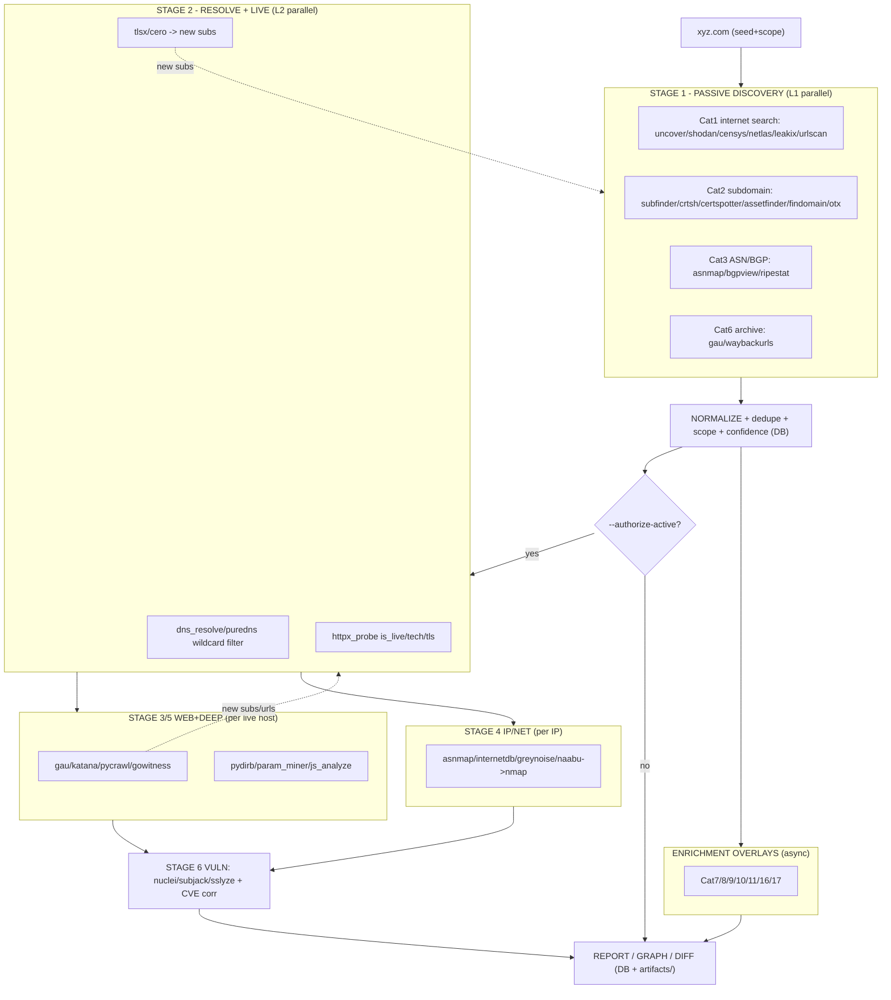

# Parallel + Recursive Architecture — all tools, one diagram

Answers: *is parallelism implemented where needed?* and *what's the full architecture
of all tools, in one flow diagram?* — with an honest map of what's parallel, what's
sequential (by data dependency), and what's recursive in the actual code.

---

## 1. Parallelism — three levels (honest status vs. code)

| Level | What runs in parallel | Implemented? | Where in code |
|-------|-----------------------|--------------|---------------|
| **L1 — tools within a phase** | all N adapters of a phase run concurrently (e.g. subfinder ∥ crtsh ∥ certspotter ∥ assetfinder ∥ hackertarget ∥ otx) | yes | `pipeline._run_phase` -> `asyncio.gather` bounded by `Semaphore(profile.global_concurrency)` |
| **L2 — inputs within a tool** | one tool fans out across its N inputs (httpx over 250 hosts, tlsx over many subs, dns_resolve over hosts) | yes | hand-written `dns_resolve`/`httpx_probe`/`naabu`/`pycrawl`/`pydirb` use `gather`+`Semaphore`; generic API/CLI adapters now `gather` per-input (bounded by `per_host_concurrency`) |
| **L3 — independent tracks** | web-enrich track ∥ IP/ASN track after live validation | NOT yet (phases run sequentially) | `pipeline.run`; described as next optimization in `05-flow-architecture.md` §6 |
| **Cross-phase** | discovery -> resolve -> enrich | sequential BY DESIGN (data dependency: need subdomains before resolving them) | `pipeline.run` phase loops |

Concurrency is **bounded and safe** by the rate profile: `global_concurrency`,
`per_host_concurrency`, `requests_per_second` (token-bucket in `net/rate_limiter.py`),
jitter, plus proxy rotation (`net/proxy_pool.py`). So "N tools in parallel" never
becomes "ban the API key / get blocked".

## 2. Recursion — honest status

| Capability | Status | Note |
|------------|--------|------|
| Re-feed discovered assets to the next stage (chaining via DB) | yes | `_gather_inputs` re-queries the canonical store between phases |
| Loop discovery again when new surface appears | partial | passive `while` loop re-runs phases, but only when the AI supervisor says `should_recurse`; default (`--no-ai`) = single pass |
| True frontier convergence (expand only NEW in-scope assets until none remain) | designed, not fully wired | spec in `06-recursive-flow.md`; current loop re-runs whole phases |

So: **parallelism = implemented at L1+L2** (the levels your example needs).
**Cross-track (L3) and full recursive convergence are designed but not fully wired** —
tracked honestly in `10-gaps-and-advancements.md`.

---

## 3. Your example, mapped to the architecture

> "n subdomain tools in parallel -> filter -> reverse-IP / dorking -> regex -> feed
> wayback -> recursive"

```
   xyz.com
      |
      v  === L1 PARALLEL: N subdomain tools (one phase) ===
         subfinder | crt.sh | certspotter | assetfinder | findomain | hackertarget
         | alienvault_otx | chaos | shodan | censys | netlas | fullhunt | urlscan
                                           |
                                           v  NORMALIZE + DEDUPE + scope filter (DB)
                                  unified subdomain set (deduped, confidence-scored)
                                           |
      +-------------------------------------+-----------------------------------+
      v (L2 parallel per host)              v (L2 parallel per host)            v (per IP)
   dns_resolve/puredns               gau | waybackurls | katana          httpx_probe -> live
   -> IPs (+ wildcard filter)        (wayback/dork URLs per subdomain)    -> resolves_to -> IPs
      |                                     |  regex extract subs from JS/urls       |
      v                                     v  (pycrawl _mine_js / param_miner)       v
   reverse-IP / ASN (asnmap,          new endpoints + params              internetdb | greynoise
   bgpview, ripestat) -> CIDRs        + NEW subdomains found ---+          | naabu -> ports
      |                                                          |
      +----------------------------> (RECURSE) <-----------------+
                 new in-scope subdomains/domains re-enter the subdomain phase
                 (bounded depth; dedupe guarantees convergence)
```

Every box at the same indentation runs **concurrently**; arrows are data handoffs
through the DB. The RECURSE arrow is the re-feed (today: supervisor-gated; design:
frontier-convergence).

---

## 4. THE master flow diagram — all 19 categories, all tools

```
ROOT DOMAIN: xyz.com
   |  seed -> scope -> scan_id
   v
=========================== STAGE 1 . PASSIVE DISCOVERY (L1 parallel) ===========================
  [Cat1 Internet search]        [Cat2 Subdomain/Passive DNS]        [Cat3 WHOIS/ASN/BGP]
   uncover shodan censys         subfinder crt.sh certspotter         asnmap bgpview ripestat
   netlas leakix fullhunt    |   assetfinder findomain chaos     |    (org->asn->cidr)
   criminalip urlscan            hackertarget otx virustotal
   greynoise(enrich)             securitytrails
   [Cat6 Archive] gau | waybackurls | waymore   [Cat4 Dork/URL] github-dorks gau (passive)
=================================================|==============================================
                                                 v  NORMALIZE -> dedupe -> scope -> confidence (DB)
                              candidate subdomains + IPs + certs + URLs   (display: all, live=?)
                                                 v
                          GATE -- active phases require --authorize-active --
                                                 v
======================== STAGE 2 . RESOLVE + LIVE VALIDATION (L2 parallel) ======================
  dns_resolve | puredns/massdns (wildcard filter)  ->  resolving hosts + IPs
  httpx_probe (per host)  ->  is_live, status, title, tech, TLS, CDN/WAF tags
  tlsx (cert SANs) | cero (cert->domains)  ->  NEW subdomains  ----(RECURSE)--> back to Stage 1
=================================================|==============================================
              +----------------------------------+----------------------------------+
              v (web track - per LIVE host)        v (IP track - per IP)              v (overlays - async)
=== STAGE 3 . WEB ENRICH (L2 ||) ===   === STAGE 4 . IP/NET (L2 ||) ===   === ENRICHMENT OVERLAYS ===
 [Cat4/6] gau katana per-host           [Cat3] asnmap->mapcidr->IPs        [Cat9] gitleaks trufflehog
 [Cat13] gowitness (screenshots)        [Cat12] internetdb shodan          [Cat10] cloud_enum s3scan
 [Cat22] pycrawl (JS dl+mine)           [Cat21] naabu->nmap (ports)        [Cat7] hunter holehe hibp
 [Cat5] httpx whatweb wafw00f           [Cat1] greynoise (tag IPs)         [Cat8] sherlock maigret
=================|==================    =============|=================     [Cat11] exiftool metagoofil
                 v                                   v                      [Cat16] ahmia onionsearch
=== STAGE 5 . DEEP (L2 ||, per url/js) ===           |  new subs/urls       [Cat15] wigle (scope-dep)
 [Cat20] pydirb (dir brute+calib)                    +---(RECURSE)--+       [Cat17] api feeds (enrich)
 [Cat22] js_analyze linkfinder secretfinder                         |       (Cat18 = reference index,
 [Cat25] param_miner + form extract                                 |        NOT executed)
=================|========================                          (re-feed)
                 v
=== STAGE 6 . VULN SURFACE (L2 ||, per live host) ===
 [Cat27] nuclei    [Cat24] subjack tko-subs sslyze     service+ver -> NVD+EPSS -> ranked findings
=================|====================================
                 v
        REPORT / EXPORT / GRAPH / DIFF      (DB + artifacts/<scan_id>/{raw,js,screenshots,bodies})

LEGEND:  || = parallel (L1 tools / L2 inputs)   RECURSE = re-feed of new in-scope assets
         GATE = authorization gate   all bounded by rate profile (concurrency/QPS/jitter) + proxy rotation
```

---

## 5. Mermaid (renders on GitHub)



---

## 6. Where each control lives (so the parallelism stays safe)

| Concern | Mechanism | File |
|---------|-----------|------|
| Tools-per-phase parallel | `asyncio.gather` + `Semaphore(global_concurrency)` | `orchestrator/pipeline.py::_run_phase` |
| Inputs-per-tool parallel | `asyncio.gather` + `Semaphore(per_host_concurrency)` | adapters + `adapters/generic.py` |
| API rate safety | per-(provider,egress) token buckets | `net/rate_limiter.py` |
| IP-ban avoidance | proxy rotation + per-egress buckets | `net/proxy_pool.py` |
| Stealth pacing | jitter + low concurrency profile | `config.py` RateProfile |
| Dedup under concurrency | deterministic `dedupe_key` + single-writer normalizer | `core/dedupe.py`, `normalize/engine.py` |
| Recursion convergence | dedupe makes the asset set monotonic -> terminates | `normalize/engine.py` + pipeline loop |

---

## 7. Honest bottom line

- **Parallelism IS implemented where it matters most**: the N discovery tools run
  concurrently (L1), and each tool fans out across its inputs concurrently (L2) — both
  bounded by the rate profile so you don't get blocked. Your example (n subdomain tools
  in parallel, then per-subdomain dorking/wayback) runs exactly this way.
- **Not yet wired**: running web-track and IP-track as two *concurrent* sub-pipelines
  (L3), and full frontier-style recursion (currently supervisor-gated, whole-phase
  re-run). Both are designed (`05`/`06`) and tracked in `10-gaps-and-advancements.md`.
